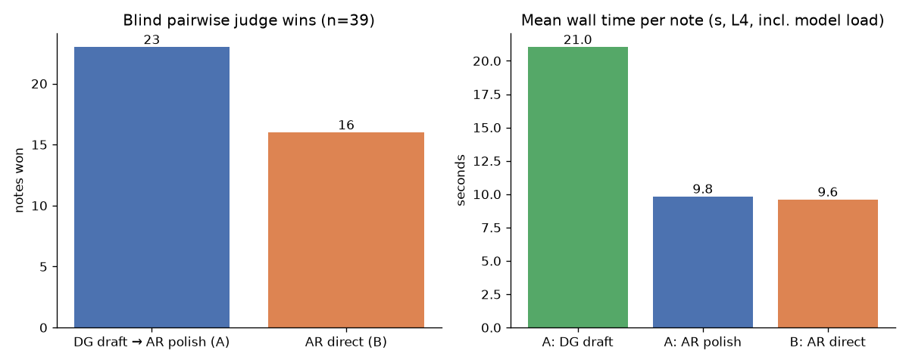

# #028 — Diffusion drafts + AR polish vs AR direct (Substack Notes)

## Question
Does drafting a short Substack Note with a diffusion LM (DiffusionGemma, `llama-diffusion-cli`) and then having an
autoregressive model polish it beat simply asking the autoregressive model to write the note directly?

## Setup
- **GPU:** Google Colab **L4** (session `claude-028`), llama.cpp built from source, all layers on GPU (`-ngl 99`).
- **Models:** DiffusionGemma GGUF (draft, 48 diffusion steps, `-n 512`); Gemma-4-26B-A4B-it UD-Q4_K_M (polish, direct write, judge).
- **Arms per topic** (topics in `work/scripts/topics.json`, prompt: 60–100 word plain-text Substack Note):
  - **A** = DG draft (C) → AR polish
  - **B** = AR direct
  - **Judge:** same AR model, blind pairwise A vs B, order randomized per note (seeded), `WINNER: X|Y`.
- AR settings: `--chat-template gemma` (avoids thinking output), temp 0.7, `-n 300`.
- Pipeline: `work/scripts/pipeline.sh`; analysis: `work/scripts/analyze.py`; raw pulled outputs: `results/raw/colab_r028_pull.json`.
- Run was planned for 50 notes and cut off at the time budget: **39 notes completed**.

## Compute
- L4 session allocated 04:02–05:00 IST = **~58 min** (setup/build ~12 min, 3 aborted launches ~13 min, final pipeline run 04:27–05:00 = 33 min).
- **CU estimate = 58 min × 1.54 / 60 ≈ 1.49 CU** (whole session).

## Results (n=39)
| Metric | A: DG draft → AR polish | B: AR direct |
|---|---|---|
| Judge wins | **23** (59%) | **16** (41%) |
| Mean words (final) | 87.4 | 81.5 |
| In 60–100 word range | 36/39 | 38/39 |
| Mean wall time / note (s) | 30.9 (draft 21.0 + polish 9.8) | 9.6 |

Unparsed judge verdicts: 0. Judge picked position X 18/39 times (no strong position bias).
DG drafts alone: mean 67.6 words, 31/39 in range.

See `writeup.md` for discussion and caveats.

### Per-note
| id | winner | words C | words A | words B | t C (s) | t A (s) | t B (s) |
|---|---|---|---|---|---|---|---|
| n01 | A | 69 | 79 | 80 | 22.5 | 9.4 | 9.5 |
| n02 | A | 74 | 78 | 83 | 23.1 | 9.6 | 9.7 |
| n03 | B | 17 | 231 | 85 | 19.9 | 13.2 | 9.7 |
| n04 | A | 21 | 78 | 77 | 20.7 | 9.7 | 9.5 |
| n05 | B | 77 | 76 | 75 | 19.0 | 9.5 | 9.4 |
| n06 | A | 82 | 90 | 84 | 20.1 | 9.7 | 9.5 |
| n07 | A | 78 | 77 | 86 | 18.4 | 9.5 | 9.6 |
| n08 | B | 78 | 221 | 78 | 21.4 | 13.2 | 9.5 |
| n09 | A | 77 | 79 | 85 | 22.5 | 9.4 | 9.5 |
| n10 | A | 43 | 84 | 83 | 20.4 | 9.5 | 9.4 |
| n11 | A | 84 | 84 | 76 | 21.9 | 9.6 | 9.4 |
| n12 | A | 78 | 88 | 85 | 21.7 | 9.8 | 9.6 |
| n13 | B | 77 | 78 | 89 | 19.8 | 9.5 | 9.8 |
| n14 | A | 74 | 80 | 86 | 21.2 | 9.7 | 9.6 |
| n15 | A | 80 | 88 | 43 | 21.2 | 9.7 | 13.1 |
| n16 | A | 6 | 83 | 75 | 20.1 | 9.5 | 9.4 |
| n17 | A | 43 | 75 | 85 | 20.1 | 9.2 | 9.4 |
| n18 | A | 79 | 85 | 82 | 21.5 | 9.6 | 9.4 |
| n19 | B | 65 | 87 | 85 | 18.5 | 9.6 | 9.4 |
| n20 | A | 65 | 84 | 79 | 22.2 | 9.7 | 9.6 |
| n21 | B | 39 | 80 | 83 | 21.3 | 9.4 | 9.5 |
| n22 | B | 80 | 75 | 75 | 20.5 | 10.2 | 9.6 |
| n23 | A | 85 | 80 | 81 | 23.0 | 9.4 | 9.4 |
| n24 | B | 79 | 78 | 92 | 19.2 | 9.4 | 9.6 |
| n25 | B | 73 | 83 | 85 | 19.7 | 9.5 | 9.6 |
| n26 | A | 79 | 88 | 79 | 20.6 | 9.6 | 9.3 |
| n27 | B | 71 | 83 | 82 | 20.6 | 9.6 | 9.4 |
| n28 | B | 76 | 84 | 88 | 21.8 | 9.5 | 9.5 |
| n29 | B | 38 | 24 | 81 | 24.2 | 13.0 | 9.4 |
| n30 | B | 82 | 80 | 81 | 21.0 | 9.7 | 9.6 |
| n31 | A | 77 | 74 | 80 | 19.2 | 9.2 | 9.4 |
| n32 | A | 78 | 88 | 83 | 20.0 | 9.5 | 9.7 |
| n33 | B | 75 | 82 | 76 | 21.0 | 9.7 | 9.6 |
| n34 | A | 77 | 74 | 86 | 22.5 | 9.4 | 9.6 |
| n35 | A | 78 | 84 | 86 | 20.4 | 9.6 | 9.8 |
| n36 | B | 78 | 83 | 80 | 22.1 | 9.6 | 9.7 |
| n37 | A | 82 | 82 | 84 | 22.3 | 9.5 | 9.5 |
| n38 | A | 77 | 76 | 93 | 21.4 | 9.4 | 9.6 |
| n39 | B | 46 | 85 | 82 | 23.5 | 9.7 | 9.5 |
